# BrightRaider

**See enemies in the dark. No alt-tab, no game files modified.**

BrightRaider is a lightweight Windows tray tool that lets you switch display brightness, contrast and digital vibrance with a single keypress — per game, auto-applied when you Alt-Tab. It works with **any** PC game; the Arc Raiders toolbox (Map Scanner, Autoscrapper, QuickSelect, QuickSave) is an **optional module** with its own page and one switch.

One small EXE, nothing to install — ready a tenth of a second after you start it. Works with any keyboard — numpad, TKL, or fully custom bindings.

  
[](https://github.com/BrightRaider/BrightRaider/releases)

**🌐 Website: [brightraider.github.io/BrightRaider](https://brightraider.github.io/BrightRaider/)**

## 🆕 What's new

**V1.4 — lighter, faster, and Arc Raiders as a module:** ready in 0.11 s and 21 MB in the tray (V1.3: 0.58 s, 105 MB), the Arc Raiders module **downloads and updates by itself**, your **own names for the Map Scanner's exits**, the crosshair remembered **per game**, and search in the settings. Coming from V1.2.3, you also get everything V1.3 brought: the **setup**, the new settings window with a **guide beside every page**, and the **G-SYNC / FreeSync setup** — [release notes](https://github.com/BrightRaider/BrightRaider/releases/tag/v1.4.0) · [Changelog](docs/CHANGELOG_PUBLIC.txt)

## Before / After

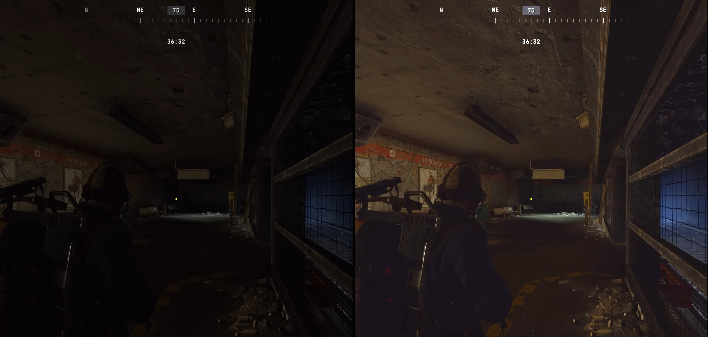

## Screenshots

Two hero shots — the rest is one click away.

<table>
<tr>
  <td valign="top" width="40%">
    <strong>Tray menu</strong><br>
    Per-profile color marker, quick toggles for Alt-Tab Auto-Switch and Auto-Brightness, monitor picker, license status, one-click Settings.
    <br><br>
    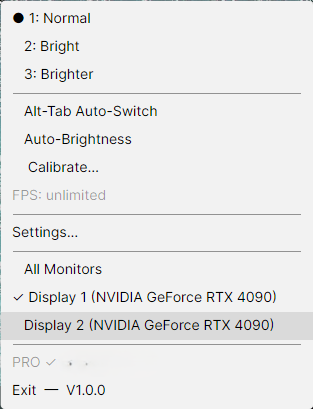
  </td>
  <td valign="top" width="60%">
    <strong>Map Scanner overlay — in-game</strong><br>
    Long-press M → ~100 % OCR hit rate, detects every current map condition, color-coded evac timers, audible alarm below threshold.
    <br><br>
    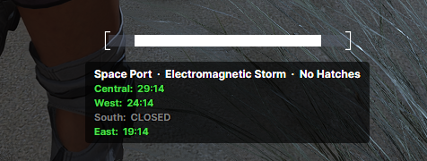
  </td>
</tr>
</table>

<details>
<summary><b>📸 See the settings window</b> (click to expand — 8 screenshots, V1.4)</summary>

<br>

**Games & FPS — the Free killer feature.** Per-game colours + FPS limit, auto-switched on Alt-Tab; the G-SYNC / FreeSync setup folded under *Advanced*.

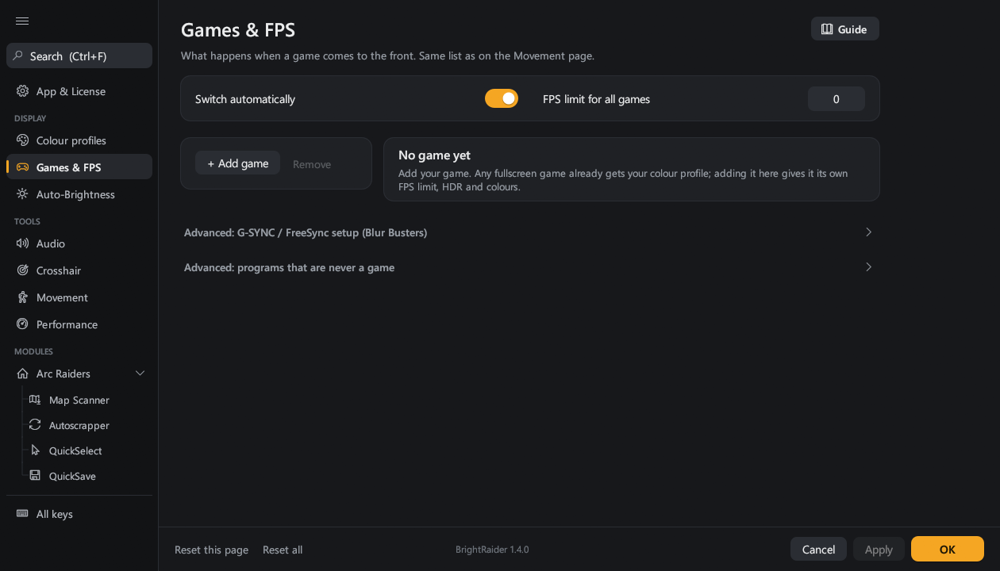

**Colour profiles.** 9 profiles, each with Gamma / Contrast / Vibrance / Shadow Boost, its key right next to it, and dimming for your other screens.

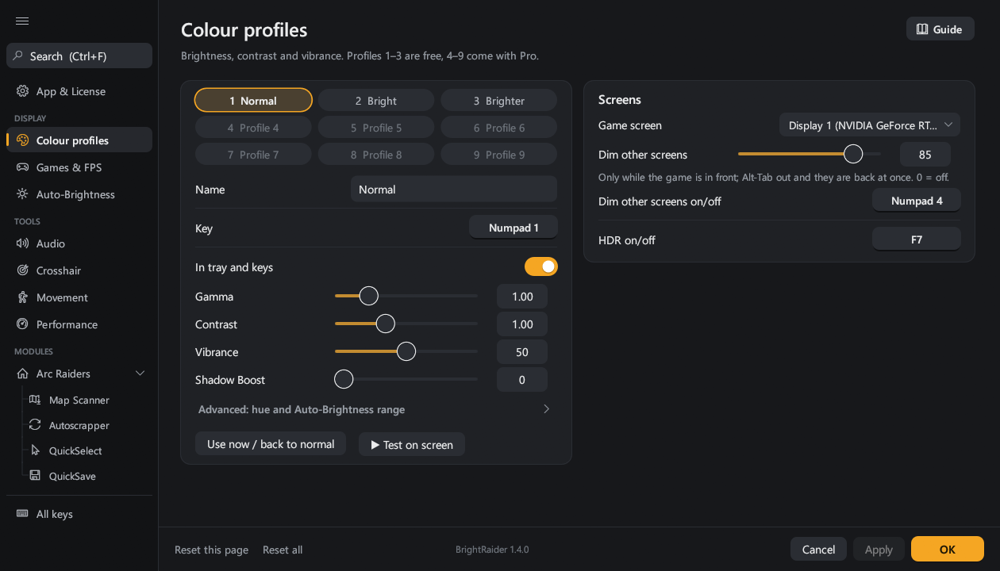

**A guide beside every page.** What happens, how to set it up, what to try when something is off — here for the Map Scanner.

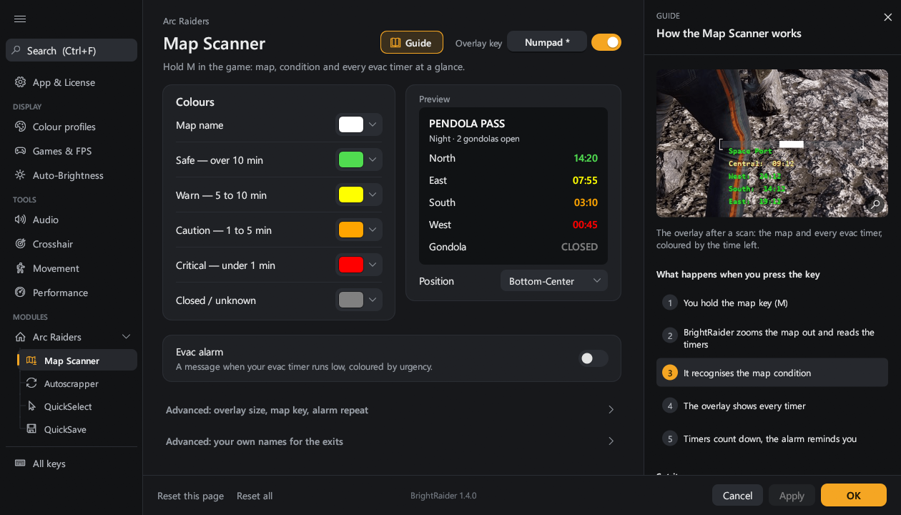

**Audio (Pro).** Mute only the game, mute teammates, Footstep Booster, output switcher — every key on the page.

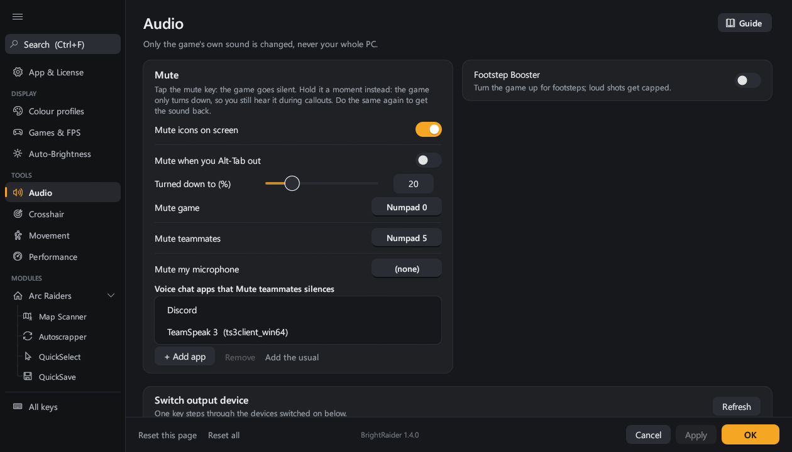

**Crosshair (Pro).** Click-through overlay, 6 styles, colour, outline, live preview — remembered per game.

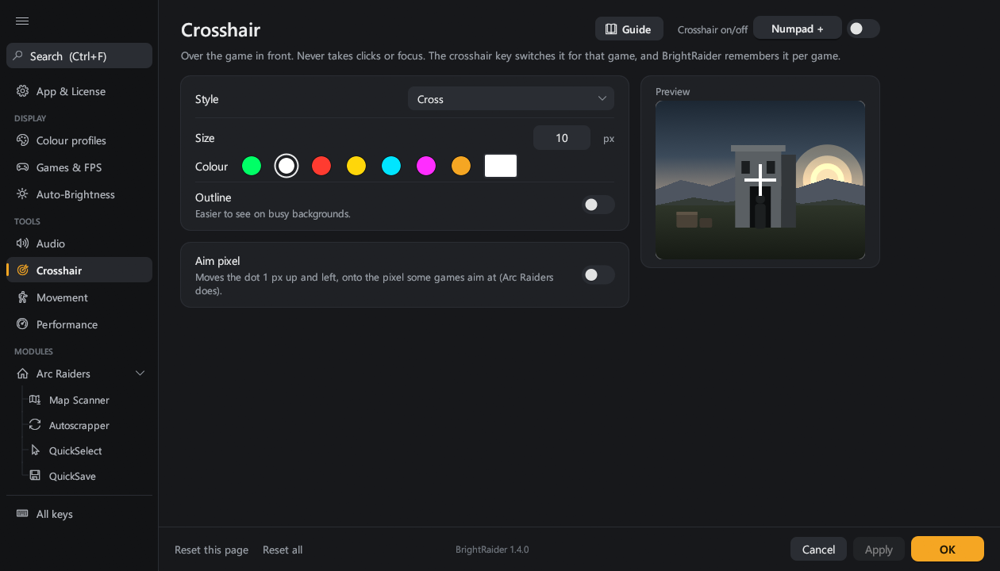

**Arc Raiders module.** All four tools on one page with their keys and one switch — the module downloads and updates by itself.

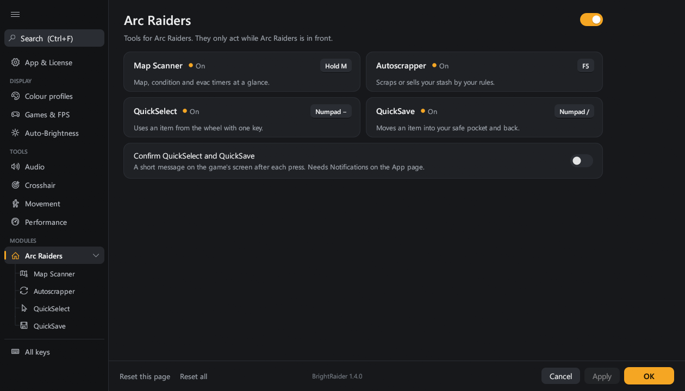

**QuickSelect (Pro).** Your game keys once in *Setup*, then one row per item; *All columns* shows the rest.

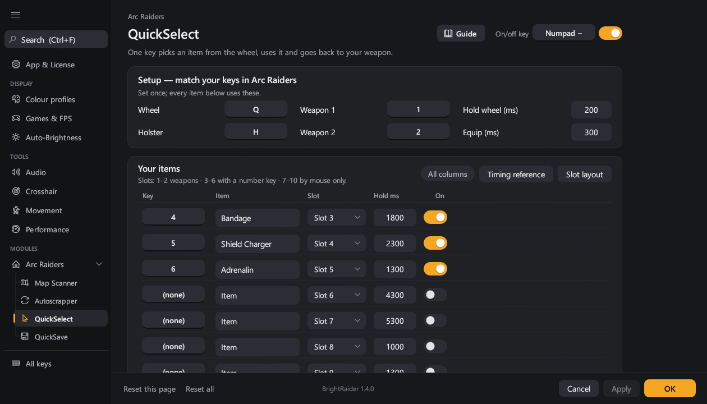

**All keys.** Every key in one place, with conflicts — each one is also on its feature's page.

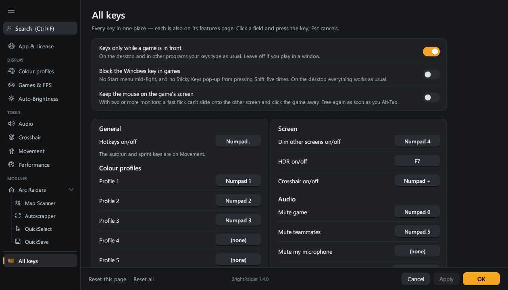

</details>

## Demo Videos

> **Note on video quality:** BrightRaider works by adjusting display output at the GPU level — the same way your monitor brightness works. Because of this, screen recording software cannot capture the actual brightness changes. The videos were recorded with a phone camera pointed at the monitor, which is why the quality is lower than usual. This is also proof that BrightRaider is not a cheat — it only changes display settings, nothing inside the game.

**Free version** — Profile switching with hotkeys (starts at 0:06):
[](https://youtu.be/ZjRZKfPi7Ok?t=6)

**Pro version** — Auto-Brightness in action:
[](https://youtu.be/q4DPRjHs24g?t=4)

## Why BrightRaider?

NVIDIA Game Filters are blocked by anti-cheat (EAC). Monitor OSD is slow and clunky. Alt-tabbing to adjust settings gets you killed.

BrightRaider's display and colour features use standard Windows display APIs — the same way your NVIDIA Control Panel or monitor settings work — and are **safe with all major anti-cheat systems** (EAC, BattlEye, Vanguard). The optional features that send input to the game are a different category — see [Anti-Cheat Safety](#anti-cheat-safety).

> **VibranceGUI is no longer needed.** BrightRaider auto-switches vibrance and FPS limits per game as you alt-tab — everything VibranceGUI does, in one place. You can uninstall it.

## Features

### Free
- **Display presets on a hotkey** — Normal / Bright / Brighter, instant even in fullscreen.
- **Game Profiles + Alt-Tab Auto-Switch** — per-game Gamma / Contrast / Vibrance / Hue and FPS limit, applied while the game is in front; colours revert on Alt-Tab, the FPS limit when the game closes. Replaces VibranceGUI.
- **Dim Other Displays** *(new in V1.2)* — darkens your other screens while the game is in front, so a bright second monitor stops pulling your eye. They come back on Alt-Tab.
- **FPS limit per game** — NVIDIA via DRS, AMD via FRTC.
- **G-SYNC / FreeSync setup** *(new in V1.3)* — V-SYNC, low latency and the right FPS limit in the driver, the way [Blur Busters](https://blurbusters.com/gsync/gsync101-input-lag-tests-and-settings/14/) recommends; competitive games can be left out, Undo puts back exactly what was there.
- **Setup and guides** *(new in V1.3)* — a short setup at the first start, and a guide beside every settings page.
- **HDR hotkey + per-game Auto-HDR** — HDR on when the game launches, off when it closes.
- **Hotkeys your way** — every key rebindable, with modifiers, mouse buttons and scroll wheel; optionally only while a game is focused. Controller players: see [the manual](docs/Manual.md#playing-with-a-controller).
- **Your calibration stays safe** — DisplayCAL / ICC gamma is saved on first launch and restored on exit, even after a crash.
- **NVIDIA, AMD and Intel** · multi-monitor, with a GPU and monitor picker · light and dark theme
- **Break reminder, update notifier, auto-start with Windows** · notifications on the screen you choose
- **Light and quick** — one portable EXE under 6 MB, nothing to install; the settings have a search (Ctrl+F) and a size slider.

### Pro (€5.49)
One key unlocks everything below, in every game — the Arc Raiders tools included. Every Pro page can be opened and set up without Pro; the tools run in your games once Pro is active.

#### For every game

- **Auto-Brightness** — samples the screen and adjusts Gamma / Contrast / Vibrance to what you see; set up in two clicks. 📖 [Guide](docs/AutoBrightness_Guide.md)
- **Profile editor + profiles 4–9** — edit Gamma / Contrast / Vibrance / Hue of every preset.
- **Footstep Booster** — per-game audio limiter: turn the game up for footsteps without gunshots blowing your ears. 📖 [Guide](docs/FootstepBooster_Guide.md)
- **Game Mute, Audio Ducking, Background AutoMute** — silence or duck only the game; muted automatically on Alt-Tab. Discord and music keep playing.
- **Mute Teammates** *(new in V1.2)* — one key silences your voice chat apps (Discord, TeamSpeak, ...) while you play; you pick the apps from a list.
- **Audio Output Switcher** — cycle speakers ↔ headphones with one key, optionally on game start.
- **Autorun** — CapsLock holds forward; tap mode for the Looting Mk. 3 augment. Sprint key, hold/toggle and tap timings per game *(new in V1.2)*.
- **Crosshair Overlay** — click-through, 6 styles, custom colour, outline and size; remembered per game, so G-SYNC stays on where you don't need it *(new in V1.4)*.
- **Process Optimizer** — High priority and physical cores only for the game in front.

#### Arc Raiders module

Part of the optional Arc Raiders module — switch it on in the setup or on its own page, *Settings → Modules → Arc Raiders*. It downloads by itself (8 MB) and updates by itself: when Arc needs a fix, the tray offers it, and only the module is downloaded *(new in V1.4)*. Keys, anti-cheat notes, manual and guides: **[Arc Raiders module](docs/modules/arc-raiders/README.md)**.

- **Autoscrapper** *(new in V1.2)* — press F5 with the stash open: it reads the whole stash and scraps or sells by your rules — by default only after you confirm the list. Sends simulated clicks to the game, see [the module's anti-cheat notes](docs/modules/arc-raiders/README.md#anti-cheat). 📖 [Guide](docs/modules/arc-raiders/Autoscrapper_Guide.md)
- **Map Scanner** — long-press M on the map: evac timers, map conditions and hatch states as a colour-coded overlay, plus an evac alarm; name the exits yourself if you like *(new in V1.4)*. Other games via data packs. 📖 [Guide](docs/modules/arc-raiders/MapScanner_Guide.md) · [Pack authoring](docs/modules/arc-raiders/pack-authoring.md)
- **QuickSelect** — one key uses an item from your quick-use wheel. 📖 [Guide](docs/modules/arc-raiders/QuickSelect_Guide.md)
- **QuickSave** — one key drags an item into your Safe Pocket or backpack and back. 📖 [Guide](docs/modules/arc-raiders/QuickSave_Guide.md)

## Default Profiles

| Key (default) | Name | Gamma | Contrast | Vibrance |
|---------------|------|-------|----------|----------|
| Num 1 | Normal | 1.0 | 100% | 50% |
| Num 2 | Bright | 1.5 | 110% | 60% |
| Num 3 | Brighter | 2.0 | 110% | 70% |
| Num 4–9 | Custom [PRO] | Editable | Editable | Editable |

All hotkeys are rebindable. Defaults shown above use the numpad preset. On Free these three presets are **switch-only** — editing any display profile's values (and unlocking 4–9) is Pro. For fully custom colors per game, use the free **Games & FPS** page.

## Download

**[Download Latest Release](../../releases/latest)**

One `BrightRaider.exe` for every keyboard — numpad, TKL or custom. A short setup appears on first launch: choose your keyboard type and your hotkeys are configured automatically. You can run it again at any time: *Settings → App & License → Run the setup…*

> **Coming from V9.x?** Your license key still works — re-enter it once under *Settings → App & License*. Activation limit reached? See the [known-issues post](https://github.com/BrightRaider/BrightRaider/issues/74).

Just download and run. No installation needed. The Arc Raiders module comes by itself when you switch it on.

<!-- TODO 1.4 release: VirusTotal link and Microsoft verdict for the V1.4.0 build; until then the V1.3.0 results stay, named as such. -->
> ⚠️ **Antivirus false positive?** Some AV tools flag BrightRaider due to its global keyboard hook (same mechanism as Logitech GHub, Razer Synapse, Discord Push-to-Talk). No data is logged or transmitted. **Verify it yourself:** [VirusTotal scan of the V1.3.0 build](https://www.virustotal.com/gui/file/80662cf00c1e420a4e5851643a283ee60a9ceb1b4613bc66eaf4da71c746dcaa) — 1 of 70 engines flags it (Bkav Pro, heuristic); Microsoft and all others show it clean. The V1.3.0 build was also submitted to **Microsoft** for analysis (18 Oct 2026); their verdict: it *"does not meet our criteria for malware or potentially unwanted applications"*. 100–200 downloads daily, zero reports — [see stats](https://github-release-stats.ghostbyte.dev/BrightRaider/BrightRaider).

<details>
<summary>📄 <b>Microsoft's analysis of the V1.3.0 build</b> (click to expand)</summary>

<br>

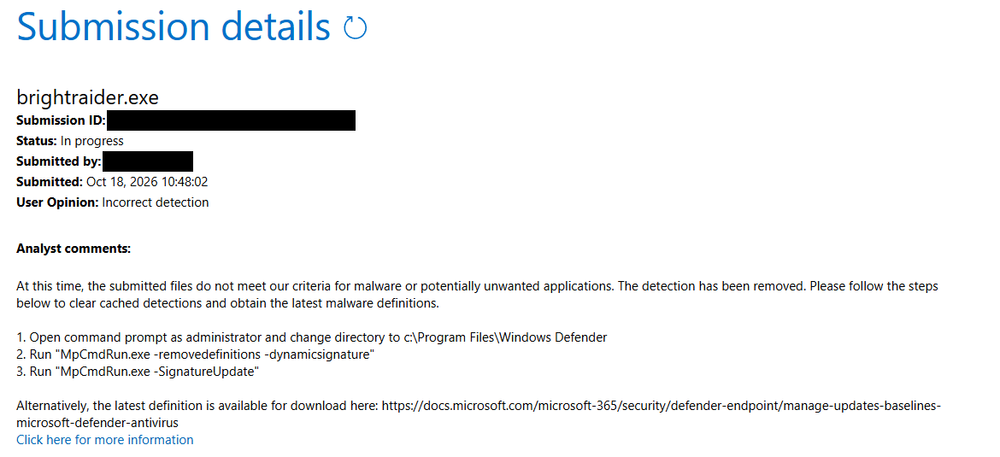

<sub>Submitted 18 October 2026 through the <a href="https://www.microsoft.com/en-us/wdsi/filesubmission">Microsoft Security Intelligence file submission portal</a>. Analyst verdict: the file does not meet the criteria for malware or potentially unwanted applications. Submission ID and submitter address redacted. Every release before it (V1.0 to V1.1.1) was submitted the same way and came back clean.</sub>

</details>

## Quick Start

1. Run `BrightRaider.exe` — the setup appears
2. Go through it: keyboard, brightness, other screens, Alt-Tab, FPS limit (or the G-SYNC / FreeSync setup), sound, crosshair, notifications
3. Decide whether you want the **Arc Raiders module** (Map Scanner, Autoscrapper, QuickSelect, QuickSave). Off by default on a fresh install — flip it any time on its page, *Settings → Modules → Arc Raiders*; it downloads by itself.
4. Press your profile key — switch brightness instantly, even in fullscreen
5. That's it. Every settings page has a **Guide** button if you want to know more.

## First Launch

On first launch, BrightRaider sets one registry entry to unlock gamma adjustment:

```
HKLM\SOFTWARE\Microsoft\Windows NT\CurrentVersion\ICM → GdiIcmGammaRange = 256
```

This tells Windows to allow gamma adjustments — used by many display calibration tools, harmless, can be removed anytime. A UAC prompt appears once. **Restart your PC after the first launch** (only needed once).

## Pro Activation

1. Buy your license:
   - **[Lemon Squeezy (€5.49)](https://brightraider.lemonsqueezy.com/checkout/buy/9b93d8c0-262f-43a4-bd41-167557efb156)**
2. *Settings → App & License → Activate Pro license…* — or **I have a key** on any Pro page
3. Paste your license key
4. Done — all Pro features unlocked permanently. No subscription. Internet required once for activation, offline forever after.

## Hotkeys (default)

> Every key is rebindable on the page of its feature, or all in one place under **Settings → All keys**.

| Numpad (default) | TKL (default) | Action | Version |
|------------------|---------------|--------|---------|
| Numpad 1–3 | ← ↓ → | Switch profile | Free |
| Numpad 4–9 | — | Switch profile (4–9) | Pro |
| Numpad 0 (short) | ↑ (short) | Mute/unmute game | Pro |
| Numpad 0 (hold 600ms) | ↑ (hold 600ms) | Audio Ducking on/off | Pro |
| Numpad + | Insert | Toggle crosshair | Pro |
| Numpad Del | Page Down | Toggle ALL hotkeys on/off | Free |
| Numpad Enter | Page Up | Cycle audio output device | Pro |
| CapsLock | CapsLock | Toggle autorun | Pro |

The Arc Raiders module's keys (timer overlay, map scan, QuickSelect, QuickSave, Autoscrapper): [on its page](docs/modules/arc-raiders/README.md#keys-defaults).

Works with NumLock on or off. **Tip: keep NumLock off while playing** — with NumLock on, Windows briefly interrupts the Shift key when you switch profiles, which can slow your character if Shift is your sprint key.

## How It Works

BrightRaider adjusts your display output using standard Windows APIs:

- **GDI** (`SetDeviceGammaRamp`) — gamma & contrast, works on every GPU
- **NvAPI** — NVIDIA Digital Vibrance; per-game FPS limits via NvAPI DRS
- **ADL** — AMD Radeon saturation + hue control
- **ADLX** — AMD per-game FPS limits via ADLX FRTC

Nothing in the game is modified and nothing is loaded into the game process. It's the equivalent of changing your monitor brightness — just faster and with presets.

### Auto-Brightness (Pro)

Analyzes 5 small zones across your screen (center + 4 corners) using median brightness measurement. Based on the result, it smoothly interpolates between your profiles. Darker screen = more boost, brighter screen = less. The transition is seamless.

Calibrate in two steps: measure the darkest spot, measure the brightest spot, done.

## Anti-Cheat Safety

BrightRaider does **NOT**:
- Modify game files or memory
- Inject DLLs into game processes or hook into the game process
- Read game data or game memory

Your hotkeys work through Windows' standard low-level keyboard/mouse hooks — system-wide, the same mechanism macro and hotkey tools use — not through anything inside the game.

**The display and colour features** use only:
- Windows GDI — same as your monitor settings
- NVIDIA NvAPI — same as NVIDIA Control Panel
- AMD ADL / ADLX — same as AMD Radeon Software

Anti-cheat systems do not flag display adjustments. **Some other features send input to the game**, and that is a different category — see below.

### What each feature does, and the risk

| Feature | What it does | Default | Risk (our estimate) |
|---|---|---|---|
| Gamma, contrast, shadows | Windows gamma ramp | on | none known |
| Vibrance, hue, FPS limit | NVIDIA / AMD driver APIs | vibrance on | none known |
| Auto-Brightness | Screenshots of your desktop | off (Pro) | none known |
| Crosshair | Click-through window on top | off (Pro) | low — check league rules |
| Autorun (walk/sprint) | Posted key messages: holds W / Shift | Pro, toggled with CapsLock | low |
| Autorun **tap mode** | Presses and releases W on a fixed interval (e.g. 160 ms every 1.3 s) — a periodic macro | Pro, long-press CapsLock | medium |

"Risk" is our assessment of how input looks to behavioural anti-cheat (such as Anybrain, used by Arc Raiders). No anti-cheat vendor has confirmed or ruled out any of these.

### Input Automation

**Autorun** holds your forward key (and sprint) with posted key messages. In **tap mode** it presses and releases forward on a fixed interval instead — that is a periodic macro with a regular timing pattern, not a single held key.

### Modules

A module sends input to its own game, and each module's page says what it sends and how exposed it is. **[Arc Raiders module](docs/modules/arc-raiders/README.md#anti-cheat)** — Map Scanner (low), QuickSelect and QuickSave (medium), and the **Autoscrapper, the most exposed feature in BrightRaider**: it clicks, moves the cursor and scrolls in the game for you, with machine-regular timing. Optional and off by default — use it at your own risk.

All input features are **optional**. If you want zero exposure, leave them off and use everything else: display, colour, FPS, Auto-Brightness and the overlay send no input at all.

### Crosshair Overlay

BrightRaider's crosshair is a transparent, click-through Windows window drawn on top of the game — the same mechanism used by Discord, GeForce Experience and TeamSpeak overlays. It is not injected into the game, does not read game memory and is not rendered by the game engine.

**In Arc Raiders, EAC does not block it (our own test):** overlay crosshairs that EAC does block stop Arc Raiders from launching at all, and BrightRaider's does not. That is an observation, not a statement from EAC.

**It does not carry over to other games or anti-cheats.** VAC is a separate system with its own tolerances, and players report bans connected to third-party crosshair overlays; leagues such as FACEIT and ESEA have their own rules. **In Counter-Strike, leave the crosshair off**, and check the rules of any game you play competitively.

## System Requirements

- Windows 10 / 11 (x64)
- **Nothing to install** — one self-contained EXE; the Arc Raiders module downloads when you switch it on
- NVIDIA or AMD GPU recommended for full feature set (Vibrance, Hue, FPS limit). Intel + integrated GPUs work with Gamma + Contrast only.

## Changelog

**[View full changelog](docs/CHANGELOG_PUBLIC.txt)**

## Manual

**📘 [Full Manual](docs/Manual.md)** — English + German, every feature explained.

## Guides

Deep-dives for the more advanced features:

- 🔆 **[Auto-Brightness Guide](docs/AutoBrightness_Guide.md)** — how the 5-zone sampler works, Calibration Wizard walkthrough, zone-weight tuning, debug overlay
- 🔊 **[Footstep Booster Guide](docs/FootstepBooster_Guide.md)** — threshold / attack / release tuning, recommended starting values, troubleshooting

**Arc Raiders module** — [its page](docs/modules/arc-raiders/README.md) (keys, anti-cheat, manual, changelog):

- 🧹 **[Autoscrapper Guide](docs/modules/arc-raiders/Autoscrapper_Guide.md)** — rules, the review screen, test run vs. live, naming unrecognised tiles
- 🗺️ **[Map Scanner Guide](docs/modules/arc-raiders/MapScanner_Guide.md)** — supported maps, event detection (all map conditions), threshold colors, Evac alarm setup, your own exit names
- ⚡ **[QuickSelect Guide](docs/modules/arc-raiders/QuickSelect_Guide.md)** — per-slot LMB hold time, modifier-key bindings, slots 7–10 mouse-movement path
- 💾 **[QuickSave Guide](docs/modules/arc-raiders/QuickSave_Guide.md)** — 5 drag presets, toggle direction, timing controls

## Uninstall

1. Turn off "Start with Windows" in *Settings → App & License*, then exit BrightRaider (right-click tray → Exit)
2. Delete `BrightRaider.exe`
3. Delete the folders `%LOCALAPPDATA%\BrightRaider` (downloaded modules) and `%APPDATA%\BrightRaider` (settings)
4. Optional: Remove `GdiIcmGammaRange` from `HKLM\...\ICM`
5. Optional: Remove auto-start from `HKCU\SOFTWARE\Microsoft\Windows\CurrentVersion\Run` if it was still on

## Feedback & Issues

Found a bug or have an idea? [Open an issue](https://github.com/BrightRaider/BrightRaider/issues/new/choose).

> This is a solo hobby project maintained in my free time. I read everything, but response times vary — there is no support contract.

## FAQ

**Does this work with other games?**
Yes. BrightRaider adjusts your display, not the game.

**Will I get banned?**
The display, colour, FPS and overlay features use the same Windows display APIs as your monitor settings — nothing injected into or read from the game — so they're anti-cheat-safe. The optional input features (Autoscrapper, QuickSave, QuickSelect, Autorun, and the Map Scanner's zoom-out) send input to the game, which is a different category; the Autoscrapper is the most exposed. In titles with behavioural anti-cheat (e.g. Arc Raiders' Anybrain) use them at your own risk. Details: [Anti-Cheat Safety](#anti-cheat-safety).

**Do I need Pro?**
Free is fully functional — profiles, per-game colours and FPS limits, Alt-Tab switching, HDR, dimming, the G-SYNC / FreeSync setup. Pro adds auto-brightness, the audio tools, the crosshair, autorun and the Arc Raiders tools (Map Scanner, Autoscrapper, QuickSelect, QuickSave) — so you never take your hand off the mouse.

**I used VibranceGUI before. Do I still need it?**
No. BrightRaider replaces it completely. Set your vibrance per game under *Settings → Games & FPS*, and BrightRaider handles switching automatically.

**I play with a controller. Does BrightRaider work?**
The display side works with no setup at all — profiles, per-game colour, FPS limit and HDR switch on their own when the game comes to the front, and none of that involves a hotkey. That's the larger half of BrightRaider and it doesn't care what you hold.

The hotkey features (QuickSave, QuickSelect, Autorun) can't be bound to a controller button. BrightRaider listens on the Windows keyboard and mouse hooks, and those never see gamepad input — a controller talks to Windows through a separate channel. It also needs to *swallow* the trigger key so the game doesn't also act on it, which polling a gamepad cannot do: the button would fire your macro **and** its normal in-game action.

A remapper solves it properly: **Steam Input**, **DS4Windows** or **reWASD** consume the controller button and send a keyboard key instead. BrightRaider then sees an ordinary key, swallowing included. Full details in the [manual](docs/Manual.md).

---

<details>
<summary><strong>Deutsche Version</strong></summary>

## BrightRaider

**Feinde im Dunkeln sehen. Kein Alt-Tab, keine Spieldateien verändert.**

BrightRaider ist ein schlankes Windows-Tray-Tool, mit dem du Helligkeit, Kontrast und Digital Vibrance per Tastendruck umschalten kannst — pro Spiel, automatisch beim Alt-Tab. Es funktioniert mit **jedem** PC-Spiel; die Arc-Raiders-Werkzeuge (Map Scanner, Autoscrapper, QuickSelect, QuickSave) sind ein **optionales Modul** mit eigener Seite und einem Schalter.

Eine kleine EXE, nichts zu installieren — eine Zehntelsekunde nach dem Start bereit. Funktioniert mit jeder Tastatur — Numpad, TKL oder komplett selbst belegt.

## 🆕 Neu

**V1.4 — leichter, schneller, Arc Raiders als Modul:** bereit in 0,11 s und 21 MB im Tray (V1.3: 0,58 s, 105 MB), das Arc-Raiders-Modul **lädt und aktualisiert sich selbst**, **eigene Namen für die Ausgänge** im Map Scanner, das Fadenkreuz **pro Spiel** gemerkt und eine Suche in den Einstellungen. Wer von V1.2.3 kommt, bekommt alles aus V1.3 dazu: den **Einrichtungsassistenten**, das neue Einstellungsfenster mit **Guide neben jeder Seite** und die **G-SYNC-/FreeSync-Einrichtung** — [Release Notes](https://github.com/BrightRaider/BrightRaider/releases/tag/v1.4.0) · [Changelog](docs/CHANGELOG_PUBLIC.txt)

## Warum BrightRaider?

NVIDIA Game Filter werden vom Anti-Cheat (EAC) blockiert. Das Monitor-OSD ist langsam und umständlich. Alt-Tab zum Einstellen bringt dich um.

BrightRaiders Anzeige- und Farbfunktionen nutzen Standard-Windows-Display-APIs — genau wie dein NVIDIA Control Panel oder deine Monitor-Einstellungen — und sind **sicher mit allen großen Anti-Cheat-Systemen** (EAC, BattlEye, Vanguard).

> **VibranceGUI wird nicht mehr benötigt.** BrightRaider schaltet Vibrance und FPS-Limit automatisch pro Spiel beim Alt-Tab — alles was VibranceGUI macht, an einem Ort. Du kannst es deinstallieren.

## Features

### Free
- **Helligkeitsprofile per Hotkey** — Normal / Hell / Heller, sofort, auch im Vollbild.
- **Spielprofile + Alt-Tab-Automatik** — Gamma / Kontrast / Vibrance / Hue und FPS-Limit pro Spiel, aktiv solange das Spiel vorne ist; die Farben gehen beim Alt-Tab zurück, das FPS-Limit, wenn das Spiel beendet wird. Ersetzt VibranceGUI.
- **Andere Bildschirme abdunkeln** *(neu in V1.2)* — dunkelt deine anderen Bildschirme, solange das Spiel vorne ist, damit ein heller Zweitmonitor nicht ablenkt. Beim Alt-Tab sind sie wieder normal.
- **FPS-Limit pro Spiel** — NVIDIA über DRS, AMD über FRTC.
- **G-SYNC-/FreeSync-Einrichtung** *(neu in V1.3)* — V-SYNC, niedrige Latenz und das passende FPS-Limit im Treiber, so wie [Blur Busters](https://blurbusters.com/gsync/gsync101-input-lag-tests-and-settings/14/) es empfiehlt; kompetitive Spiele lassen sich ausnehmen, Rückgängig stellt genau das Vorherige wieder her.
- **Einrichtung und Anleitungen** *(neu in V1.3)* — ein kurzer Assistent beim ersten Start und ein Guide neben jeder Einstellungsseite.
- **HDR per Hotkey + Auto-HDR pro Spiel** — HDR an beim Spielstart, aus beim Beenden.
- **Hotkeys nach Wunsch** — jede Taste frei belegbar, mit Modifikatoren, Maustasten und Mausrad; auf Wunsch nur, solange ein Spiel im Fokus ist.
- **Deine Kalibrierung bleibt erhalten** — DisplayCAL-/ICC-Gamma wird beim ersten Start gesichert und beim Beenden wiederhergestellt, auch nach einem Absturz.
- **NVIDIA, AMD und Intel** · Multi-Monitor, mit Grafikkarten- und Monitorauswahl · helles und dunkles Design
- **Pausen-Erinnerung, Update-Hinweis, Autostart mit Windows** · Benachrichtigungen auf dem Bildschirm deiner Wahl
- **Leicht und schnell** — eine portable EXE unter 6 MB, nichts zu installieren; Suche (Strg+F) und Größenregler in den Einstellungen.

### Pro (5,49 €)
Ein Schlüssel schaltet alles unten frei, in jedem Spiel — die Arc-Raiders-Werkzeuge eingeschlossen. Jede Pro-Seite lässt sich auch ohne Pro öffnen und einrichten; im Spiel laufen die Werkzeuge, sobald Pro aktiv ist.

#### Für jedes Spiel

- **Auto-Helligkeit** — misst den Bildschirm und passt Gamma / Kontrast / Vibrance an das an, was du siehst; eingerichtet in zwei Klicks. 📖 [Anleitung (EN)](docs/AutoBrightness_Guide.md)
- **Profil-Editor + Profile 4–9** — Gamma / Kontrast / Vibrance / Hue jedes Profils anpassen.
- **Footstep Booster** — Audio-Limiter nur fürs Spiel: laut genug für Schritte, ohne dass Schüsse zu laut werden. 📖 [Anleitung (EN)](docs/FootstepBooster_Guide.md)
- **Game Mute, Audio Ducking, Background-AutoMute** — nur das Spiel stumm oder leiser; beim Alt-Tab automatisch stumm. Discord und Musik laufen weiter.
- **Mitspieler stummschalten** *(neu in V1.2)* — eine Taste schaltet deine Voice-Chat-Apps (Discord, TeamSpeak, ...) während des Spiels stumm; die Apps wählst du aus einer Liste.
- **Audio-Ausgabe-Switcher** — Boxen ↔ Kopfhörer per Taste, auf Wunsch automatisch beim Spielstart.
- **Autorun** — CapsLock hält die Vorwärtstaste; Tap-Modus für das Looting-Mk.-3-Augment. Sprint-Taste, Halten/Umschalten und Tap-Timing pro Spiel *(neu in V1.2)*.
- **Crosshair-Overlay** — click-through, 6 Stile, Farbe, Umriss und Größe frei wählbar; pro Spiel gemerkt, damit G-SYNC dort an bleibt, wo du es nicht brauchst *(neu in V1.4)*.
- **Process Optimizer** — hohe Priorität und nur physische Kerne für das Spiel im Vordergrund.

#### Arc-Raiders-Modul

Teil des optionalen Arc-Raiders-Moduls — einschalten im Einrichtungsassistenten oder auf seiner Seite, *Einstellungen → Modules → Arc Raiders*. Es lädt sich selbst herunter (8 MB) und aktualisiert sich selbst: Braucht Arc einen Fix, bietet ihn das Tray an, und nur das Modul wird geladen *(neu in V1.4)*. Tasten, Anti-Cheat-Hinweise, Handbuch und Anleitungen: **[Arc-Raiders-Modul](docs/modules/arc-raiders/README.md#deutsch)**.

- **Autoscrapper** *(neu in V1.2)* — F5 bei offenem Lager: liest das ganze Lager und verschrottet oder verkauft nach deinen Regeln — standardmäßig erst, nachdem du die Liste bestätigt hast. Sendet simulierte Klicks ans Spiel, siehe [die Anti-Cheat-Hinweise des Moduls](docs/modules/arc-raiders/README.md#anti-cheat-de). 📖 [Anleitung (EN)](docs/modules/arc-raiders/Autoscrapper_Guide.md)
- **Map Scanner** — M auf der Karte gedrückt halten: Evac-Timer, Kartenereignisse und Luken als farbiges Overlay, dazu ein Evac-Alarm; die Ausgänge kannst du selbst benennen *(neu in V1.4)*. Andere Spiele per Datenpack. 📖 [Anleitung (EN)](docs/modules/arc-raiders/MapScanner_Guide.md) · [Datenpacks](docs/modules/arc-raiders/pack-authoring.md)
- **QuickSelect** — eine Taste benutzt ein Item aus dem Schnellrad. 📖 [Anleitung (EN)](docs/modules/arc-raiders/QuickSelect_Guide.md)
- **QuickSave** — eine Taste zieht ein Item in die Sicherheitstasche oder den Rucksack und zurück. 📖 [Anleitung (EN)](docs/modules/arc-raiders/QuickSave_Guide.md)

## Download

**[Neueste Version herunterladen](../../releases/latest)**

Eine `BrightRaider.exe` für jede Tastatur — Numpad, TKL oder eigene Belegung. Beim ersten Start erscheint ein kurzer Einrichtungsassistent: Tastaturtyp wählen, Hotkeys werden automatisch gesetzt. Jederzeit wieder: *Einstellungen → App & License → Run the setup…* Das Arc-Raiders-Modul kommt von selbst, sobald du es einschaltest.

## Tastenbelegung (Standard)

> Jede Taste ist auf der Seite ihrer Funktion belegbar, oder alle an einem Ort unter **Einstellungen → All keys**.

| Numpad (Standard) | TKL (Standard) | Aktion | Version |
|-------------------|----------------|--------|---------|
| Numpad 1–3 | ← ↓ → | Profil wechseln | Free |
| Numpad 4–9 | — | Profil wechseln (4–9) | Pro |
| Numpad 0 (kurz) | ↑ (kurz) | Spiel stumm/laut | Pro |
| Numpad 0 (600ms) | ↑ (600ms) | Audio Ducking an/aus | Pro |
| Numpad + | Einfg | Fadenkreuz an/aus | Pro |
| Numpad Entf | Bild↓ | ALLE Hotkeys an/aus | Free |
| Numpad Enter | Bild↑ | Audio-Ausgabegerät umschalten | Pro |
| CapsLock | CapsLock | Autorun an/aus | Pro |

Die Tasten des Arc-Raiders-Moduls (Timer-Overlay, Karten-Scan, QuickSelect, QuickSave, Autoscrapper): [auf seiner Seite](docs/modules/arc-raiders/README.md#tasten-standard).

## Anti-Cheat Sicherheit

BrightRaider verändert **KEINE** Spieldateien und keinen Spielspeicher, injiziert nichts ins Spiel und hängt sich nicht in den Spielprozess. Deine Hotkeys laufen über die normalen systemweiten Tastatur-/Maus-Hooks von Windows, wie bei Makro- und Hotkey-Tools.

**Die Anzeige- und Farbfunktionen** nutzen nur Standard-Windows-APIs (GDI, NvAPI, ADL/ADLX) — wie das NVIDIA Control Panel oder AMD Radeon Software. **Einige andere Funktionen senden Eingaben ans Spiel**, das ist eine andere Kategorie:

| Funktion | Was sie tut | Standard | Risiko (unsere Einschätzung) |
|---|---|---|---|
| Gamma, Kontrast, Schatten | Windows-Gamma-Rampe | an | keins bekannt |
| Vibrance, Farbton, FPS-Limit | NVIDIA-/AMD-Treiber-APIs | Vibrance an | keins bekannt |
| Auto-Helligkeit | Screenshots vom Desktop | aus (Pro) | keins bekannt |
| Fadenkreuz | Durchklickbares Fenster obendrauf | aus (Pro) | niedrig — Liga-Regeln prüfen |
| Autorun (Gehen/Sprinten) | Gepostete Tastennachrichten: hält W / Shift | Pro, CapsLock | niedrig |
| Autorun **Tap-Modus** | Drückt und löst W in festem Takt (z. B. 160 ms alle 1,3 s) — ein periodisches Makro | Pro, CapsLock lang drücken | mittel |

„Risiko“ ist unsere Einschätzung, wie die Eingaben für verhaltensbasiertes Anti-Cheat (z. B. Anybrain in Arc Raiders) aussehen. Kein Anti-Cheat-Hersteller hat eine dieser Funktionen bestätigt oder ausgeschlossen.

**Autorun** hält Vorwärts (und Sprint) per geposteter Tastennachricht. Im **Tap-Modus** drückt und löst es Vorwärts in festem Takt — ein periodisches Makro mit regelmäßigem Timing, kein einzelner gehaltener Tastendruck.

**Module** senden Eingaben an ihr eigenes Spiel; die Seite jedes Moduls sagt, was es sendet und wie exponiert es ist. **[Arc-Raiders-Modul](docs/modules/arc-raiders/README.md#anti-cheat-de)** — Map Scanner (niedrig), QuickSelect und QuickSave (mittel) und der **Autoscrapper, die am stärksten exponierte Funktion von BrightRaider**: Er klickt, bewegt den Cursor und scrollt für dich, in maschinell gleichmäßigem Takt. Optional, standardmäßig aus, Nutzung auf eigenes Risiko.

Alle Eingabe-Funktionen sind **optional**. Wer kein Risiko will, lässt sie aus: Anzeige, Farbe, FPS, Auto-Helligkeit und Overlay senden keinerlei Eingaben.

**Crosshair-Overlay:** ein transparentes, durchklickbares Windows-Fenster, dieselbe Technik wie bei Discord- oder GeForce-Overlays — nicht injiziert, kein Speicherzugriff, nicht in der Engine gerendert. **In Arc Raiders blockiert EAC es nicht (eigener Test)**: Crosshair-Overlays, die EAC blockiert, verhindern den Start von Arc Raiders, BrightRaiders nicht — eine Beobachtung, keine Aussage von EAC. **Das lässt sich nicht auf andere Spiele übertragen** — VAC ist ein eigenes System, aus der Counter-Strike-Szene werden Sperren im Zusammenhang mit fremden Crosshair-Overlays berichtet, und Ligen wie FACEIT oder ESEA haben eigene Regeln. **In Counter-Strike den Crosshair auslassen** und bei kompetitiven Spielen die Regeln prüfen.

## FAQ

**Funktioniert das auch mit anderen Spielen?**
Ja. BrightRaider passt den Bildschirm an, nicht das Spiel.

**Werde ich gebannt?**
Die Anzeige-, Farb-, FPS- und Overlay-Funktionen nutzen die gleichen Windows-Display-APIs wie deine Monitor-Einstellungen — nichts wird ins Spiel injiziert oder aus ihm gelesen — sie sind also anti-cheat-sicher. Die optionalen Eingabe-Funktionen (Autoscrapper, QuickSave, QuickSelect, Autorun und das Rauszoomen des Map Scanners) senden Eingaben ans Spiel, das ist eine andere Kategorie; am stärksten exponiert ist der Autoscrapper. In Titeln mit verhaltensbasiertem Anti-Cheat (z. B. Arc Raiders' Anybrain) auf eigenes Risiko. Details: [Anti-Cheat Sicherheit](#anti-cheat-sicherheit).

**Brauche ich Pro?**
Free ist voll funktionsfähig — Profile, Farben und FPS-Limit pro Spiel, Alt-Tab-Automatik, HDR, Abdunkeln, die G-SYNC-/FreeSync-Einrichtung. Pro fügt Auto-Helligkeit, die Audio-Werkzeuge, das Fadenkreuz, Autorun und die Arc-Raiders-Werkzeuge (Map Scanner, Autoscrapper, QuickSelect, QuickSave) hinzu.

**Ich hatte VibranceGUI. Brauche ich das noch?**
Nein. BrightRaider ersetzt es vollständig. Vibrance und FPS-Limit pro Spiel unter *Einstellungen → Games & FPS* einstellen, BrightRaider übernimmt den Rest.

**Ich spiele mit Controller. Funktioniert BrightRaider?**
Die Anzeigeseite funktioniert ganz ohne Einrichtung — Profile, Farben pro Spiel, FPS-Limit und HDR schalten von selbst um, sobald das Spiel in den Vordergrund kommt. Dafür braucht es keinen Hotkey. Das ist der größere Teil von BrightRaider, und ihm ist egal, was du in der Hand hältst.

Die Hotkey-Funktionen (QuickSave, QuickSelect, Autorun) lassen sich nicht auf eine Controller-Taste legen. BrightRaider lauscht an den Windows-Hooks für Tastatur und Maus, und die sehen Gamepad-Eingaben grundsätzlich nicht — ein Controller spricht über einen getrennten Kanal mit Windows. Dazu kommt: Die Auslösetaste muss **geschluckt** werden, damit das Spiel sie nicht ebenfalls verarbeitet. Beim Abfragen eines Gamepads geht das nicht — die Taste würde dein Makro auslösen **und** ihre normale Spielfunktion.

Sauber lösen lässt es sich mit einem Remapper: **Steam Input**, **DS4Windows** oder **reWASD** fangen die Controller-Taste ab und senden eine Tastatureingabe. BrightRaider sieht dann eine normale Taste — inklusive Schlucken. Ausführlich im [Handbuch](docs/Manual.md).

</details>

---

Made for the Arc Raiders community.
