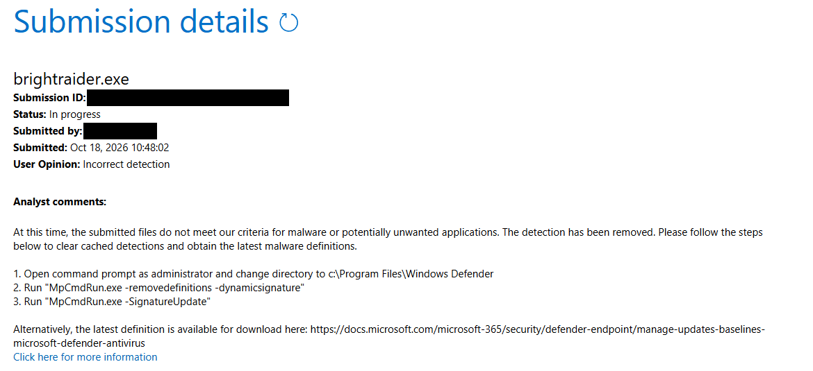

# BrightRaider — Anti-cheat safety

What BrightRaider does to your PC and your games, feature by feature, and how
exposed each one is.

> 🇬🇧 **English** below · 🇩🇪 **[Deutsch weiter unten](#deutsch)**

---

## English

### How it works

BrightRaider adjusts your display output using standard Windows APIs:

- **GDI** (`SetDeviceGammaRamp`) — gamma & contrast, works on every GPU
- **NvAPI** — NVIDIA Digital Vibrance; per-game FPS limits via NvAPI DRS
- **ADL** — AMD Radeon saturation + hue control
- **ADLX** — AMD per-game FPS limits via ADLX FRTC

Nothing in the game is modified and nothing is loaded into the game process. It's the equivalent of changing your monitor brightness — just faster and with presets.

### What it does not do

BrightRaider does **NOT**:
- Modify game files or memory
- Inject DLLs into game processes or hook into the game process
- Read game data or game memory

Your hotkeys work through Windows' standard low-level keyboard/mouse hooks — system-wide, the same mechanism macro and hotkey tools use — not through anything inside the game.

**The display and colour features** use only:
- Windows GDI — same as your monitor settings
- NVIDIA NvAPI — same as NVIDIA Control Panel
- AMD ADL / ADLX — same as AMD Radeon Software

Anti-cheat systems do not flag display adjustments. **Some other features send input to the game**, and that is a different category — see below.

#### What each feature does, and the risk

| Feature | What it does | Default | Risk (our estimate) |
|---|---|---|---|
| Gamma, contrast, shadows | Windows gamma ramp | on | none known |
| Vibrance, hue, FPS limit | NVIDIA / AMD driver APIs | vibrance on | none known |
| Auto-Brightness | Screenshots of your desktop | off (Pro) | none known |
| Crosshair | Click-through window on top | off (Pro) | low — check league rules |
| Autorun (walk/sprint) | Posted key messages: holds W / Shift | Pro, toggled with CapsLock | low |
| Autorun **tap mode** | Presses and releases W on a fixed interval (e.g. 160 ms every 1.3 s) — a periodic macro | Pro, long-press CapsLock | medium |

"Risk" is our assessment of how input looks to behavioural anti-cheat (such as Anybrain, used by Arc Raiders). No anti-cheat vendor has confirmed or ruled out any of these.

#### Input Automation

**Autorun** holds your forward key (and sprint) with posted key messages. In **tap mode** it presses and releases forward on a fixed interval instead — that is a periodic macro with a regular timing pattern, not a single held key.

#### Modules

A module sends input to its own game, and each module's page says what it sends and how exposed it is. **[Arc Raiders module](modules/arc-raiders/README.md#anti-cheat)** — Map Scanner (low), QuickSelect and QuickSave (medium), and the **Autoscrapper, the most exposed feature in BrightRaider**: it clicks, moves the cursor and scrolls in the game for you, with machine-regular timing. Optional and off by default — use it at your own risk.

All input features are **optional**. If you want zero exposure, leave them off and use everything else: display, colour, FPS, Auto-Brightness and the overlay send no input at all.

#### Crosshair Overlay

BrightRaider's crosshair is a transparent, click-through Windows window drawn on top of the game — the same mechanism used by Discord, GeForce Experience and TeamSpeak overlays. It is not injected into the game, does not read game memory and is not rendered by the game engine.

**In Arc Raiders, EAC does not block it (our own test):** overlay crosshairs that EAC does block stop Arc Raiders from launching at all, and BrightRaider's does not. That is an observation, not a statement from EAC.

**It does not carry over to other games or anti-cheats.** VAC is a separate system with its own tolerances, and players report bans connected to third-party crosshair overlays; leagues such as FACEIT and ESEA have their own rules. **In Counter-Strike, leave the crosshair off**, and check the rules of any game you play competitively.

#### Will I get banned?

The display, colour, FPS and overlay features use the same Windows display APIs as your monitor settings — nothing injected into or read from the game — so they're anti-cheat-safe. The optional input features (Autoscrapper, QuickSave, QuickSelect, Autorun, and the Map Scanner's zoom-out) send input to the game, which is a different category; the Autoscrapper is the most exposed. In titles with behavioural anti-cheat (e.g. Arc Raiders' Anybrain) use them at your own risk.

### Antivirus

<!-- TODO 1.4 release: VirusTotal link and Microsoft verdict for the V1.4.0 build; until then the V1.3.0 results stay, named as such. -->
Some AV tools flag BrightRaider due to its global keyboard hook (same mechanism as Logitech GHub, Razer Synapse, Discord Push-to-Talk). No data is logged or transmitted. **Verify it yourself:** [VirusTotal scan of the V1.3.0 build](https://www.virustotal.com/gui/file/80662cf00c1e420a4e5851643a283ee60a9ceb1b4613bc66eaf4da71c746dcaa) — 1 of 70 engines flags it (Bkav Pro, heuristic); Microsoft and all others show it clean. The V1.3.0 build was also submitted to **Microsoft** for analysis (18 Oct 2026); their verdict: it *"does not meet our criteria for malware or potentially unwanted applications"*. 100–200 downloads daily, zero reports — [see stats](https://github-release-stats.ghostbyte.dev/BrightRaider/BrightRaider).

📄 <b>Microsoft's analysis of the V1.3.0 build</b> (click to expand)

 

Submitted 18 October 2026 through the <a href="https://www.microsoft.com/en-us/wdsi/filesubmission">Microsoft Security Intelligence file submission portal</a>. Analyst verdict: the file does not meet the criteria for malware or potentially unwanted applications. Submission ID and submitter address redacted. Every release before it (V1.0 to V1.1.1) was submitted the same way and came back clean.

---

## Deutsch

### So funktioniert es

BrightRaider passt die Bildausgabe mit Standard-Windows-APIs an:

- **GDI** (`SetDeviceGammaRamp`) — Gamma und Kontrast, auf jeder Grafikkarte
- **NvAPI** — NVIDIA Digital Vibrance; FPS-Limit pro Spiel über NvAPI DRS
- **ADL** — Sättigung und Farbton bei AMD Radeon
- **ADLX** — FPS-Limit pro Spiel bei AMD über ADLX FRTC

Am Spiel wird nichts verändert, nichts in den Spielprozess geladen. Es ist wie
die Helligkeit am Monitor zu ändern — nur schneller und mit Profilen.

### Was es nicht tut

BrightRaider verändert **KEINE** Spieldateien und keinen Spielspeicher, injiziert nichts ins Spiel und hängt sich nicht in den Spielprozess. Deine Hotkeys laufen über die normalen systemweiten Tastatur-/Maus-Hooks von Windows, wie bei Makro- und Hotkey-Tools.

**Die Anzeige- und Farbfunktionen** nutzen nur Standard-Windows-APIs (GDI, NvAPI, ADL/ADLX) — wie das NVIDIA Control Panel oder AMD Radeon Software. **Einige andere Funktionen senden Eingaben ans Spiel**, das ist eine andere Kategorie:

| Funktion | Was sie tut | Standard | Risiko (unsere Einschätzung) |
|---|---|---|---|
| Gamma, Kontrast, Schatten | Windows-Gamma-Rampe | an | keins bekannt |
| Vibrance, Farbton, FPS-Limit | NVIDIA-/AMD-Treiber-APIs | Vibrance an | keins bekannt |
| Auto-Helligkeit | Screenshots vom Desktop | aus (Pro) | keins bekannt |
| Fadenkreuz | Durchklickbares Fenster obendrauf | aus (Pro) | niedrig — Liga-Regeln prüfen |
| Autorun (Gehen/Sprinten) | Gepostete Tastennachrichten: hält W / Shift | Pro, CapsLock | niedrig |
| Autorun **Tap-Modus** | Drückt und löst W in festem Takt (z. B. 160 ms alle 1,3 s) — ein periodisches Makro | Pro, CapsLock lang drücken | mittel |

„Risiko“ ist unsere Einschätzung, wie die Eingaben für verhaltensbasiertes Anti-Cheat (z. B. Anybrain in Arc Raiders) aussehen. Kein Anti-Cheat-Hersteller hat eine dieser Funktionen bestätigt oder ausgeschlossen.

**Autorun** hält Vorwärts (und Sprint) per geposteter Tastennachricht. Im **Tap-Modus** drückt und löst es Vorwärts in festem Takt — ein periodisches Makro mit regelmäßigem Timing, kein einzelner gehaltener Tastendruck.

**Module** senden Eingaben an ihr eigenes Spiel; die Seite jedes Moduls sagt, was es sendet und wie exponiert es ist. **[Arc-Raiders-Modul](modules/arc-raiders/README.md#anti-cheat-de)** — Map Scanner (niedrig), QuickSelect und QuickSave (mittel) und der **Autoscrapper, die am stärksten exponierte Funktion von BrightRaider**: Er klickt, bewegt den Cursor und scrollt für dich, in maschinell gleichmäßigem Takt. Optional, standardmäßig aus, Nutzung auf eigenes Risiko.

Alle Eingabe-Funktionen sind **optional**. Wer kein Risiko will, lässt sie aus: Anzeige, Farbe, FPS, Auto-Helligkeit und Overlay senden keinerlei Eingaben.

**Crosshair-Overlay:** ein transparentes, durchklickbares Windows-Fenster, dieselbe Technik wie bei Discord- oder GeForce-Overlays — nicht injiziert, kein Speicherzugriff, nicht in der Engine gerendert. **In Arc Raiders blockiert EAC es nicht (eigener Test)**: Crosshair-Overlays, die EAC blockiert, verhindern den Start von Arc Raiders, BrightRaiders nicht — eine Beobachtung, keine Aussage von EAC. **Das lässt sich nicht auf andere Spiele übertragen** — VAC ist ein eigenes System, aus der Counter-Strike-Szene werden Sperren im Zusammenhang mit fremden Crosshair-Overlays berichtet, und Ligen wie FACEIT oder ESEA haben eigene Regeln. **In Counter-Strike den Crosshair auslassen** und bei kompetitiven Spielen die Regeln prüfen.

#### Werde ich gebannt?

Die Anzeige-, Farb-, FPS- und Overlay-Funktionen nutzen die gleichen Windows-Display-APIs wie deine Monitor-Einstellungen — nichts wird ins Spiel injiziert oder aus ihm gelesen — sie sind also anti-cheat-sicher. Die optionalen Eingabe-Funktionen (Autoscrapper, QuickSave, QuickSelect, Autorun und das Rauszoomen des Map Scanners) senden Eingaben ans Spiel, das ist eine andere Kategorie; am stärksten exponiert ist der Autoscrapper. In Titeln mit verhaltensbasiertem Anti-Cheat (z. B. Arc Raiders' Anybrain) auf eigenes Risiko.

### Virenscanner

Manche Virenscanner melden BrightRaider wegen des globalen Tastatur-Hooks (dieselbe Technik wie Logitech G HUB, Razer Synapse, Discord Push-to-Talk) — ein bekannter Fehlalarm. Die Prüfungen durch VirusTotal und Microsoft: [Antivirus](#antivirus).
